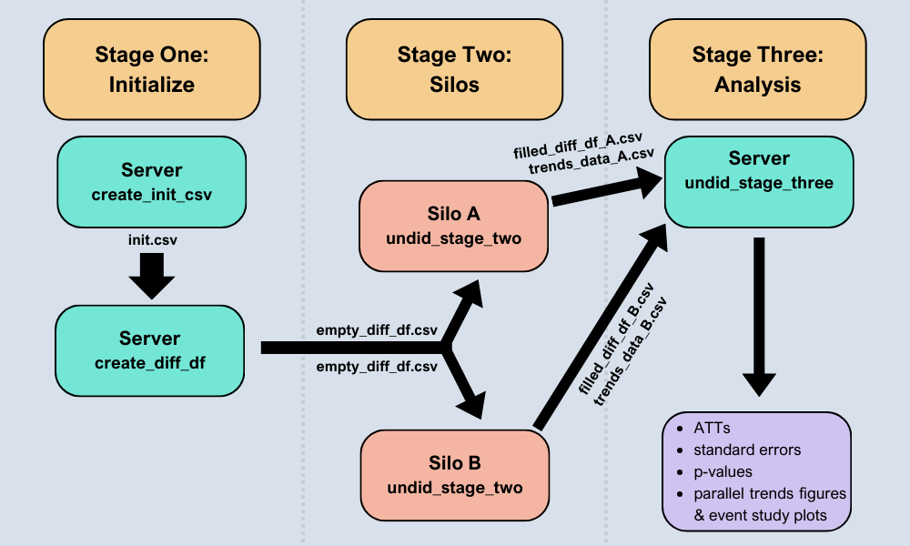
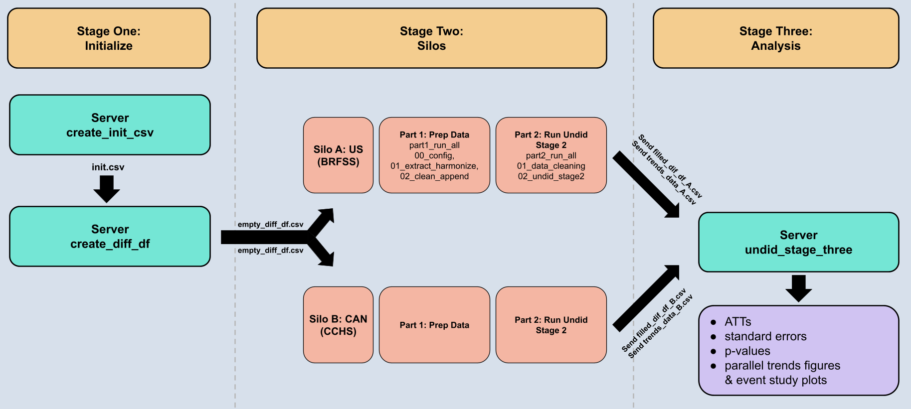

# Difference in Difference with Unpoolable Data (UN-DID): Effects of Cannabis Legalization on Usage

This repository contains code for an example paper of the undidR package developed in [Karim, Webb, Austin, and Strumpf (2025)](https://arxiv.org/abs/2403.15910v2). UndidR is designed to estimate the average treatment effect on the treated (ATT) in settings where data from different silos cannot be pooled together (potentially for reasons of confidentiality). 

To demonstrate the use of the package the example of cannabis legalization on usage is investigated. The question is the effect of Canada's cannabis legalization (17 October 2018) on cannabis use. The treated silo is Canada, measured with the CCHS (Canadian Community Health Survey). The control silo is six US states, measured with the BRFSS (Behavioral Risk Factor Surveillance System). Neither silo's data can be shared with the other, so the analysis uses the [undidR package](https://ebjamieson97.github.io/undidR/). This example paper goes through both common and staggered adoption scenarios. 


 
## UndidR: General Overview


 
*Figure 1. UndidR overview from (<https://ebjamieson97.github.io/undidR/>). Note the diagram calls Central the "Server".*
Only summary files move between silos, never the survey data.
 
UN-DID lets several groups estimate one difference-in-differences effect without ever pooling their data. Each silo keeps its own survey data and shares only a csv. The server or central coordinates the silos, sets up the analysis and puts the results together. UN-DID happens in three stages. 
 
**Stage one (Central).** Central sets up the design and records it in a file called `empty_diff_df.csv`, which it sends to every silo. Besides the empty result columns that each silo later fills in, the file defines the following:
- **Silo names and treatment/control:** the silo names (`silo_name`) and which are treated (`treat`, 1 = treated, 0 = control). Each silo's name in its own data must match this exactly.
- **Treatment timing:** `common_treatment_time` for common adoption. For staggered adoption the file instead gives the treatment year per silo (`gvar`) and one row per before-and-after comparison (`diff_times`, `gt`).
- **Timing format:** `start_time`, `end_time`, `date_format` (for example `yyyy`) and `freq` (for example `1 year`). The time column in each silo's data has to follow these.
- **Covariates:** the exact column names in `covariates`, separated by semicolons. Each silo's data must contain a column with each of these names, so categorical variables are already spelled out as dummy columns (for example `ageg62`, `hh_inc3`).
- **Weights stuff?:** `weights` column note here? `none` `diff` `att` `both` maybe not necessary? ask kwasi
 
**Stage two (each silo).** Each silo prepares its own data so that it matches Central's file. This means matching the variable names, the categories of each variable (notes on harmonization below, ask Kwasi re this) and the silo name. The silo then runs undidR on its own data. This produces two summary files, `filled_diff_df_<silo>.csv` and `trends_data_<silo>.csv`, which the silo sends back to Central. No survey data leaves the silo.
 
**Stage three (Central).** Central combines the filled files from every silo and estimates the overall treatment effect.

---
## UndidR: Example Overview 

*Figure 2. UndidR example overview adapted from (<https://ebjamieson97.github.io/undidR/>). Note the diagram calls Central the "Server".*

This paper aims to answer the question if  Canada's legalization of recreational cannabis on 17 October 2018 change the share of people who used cannabis in the past 30 days? There are two silos in this project. Canada as the treated silo using data from the CCHS, while 6 states in the US that did not legalize marijuana are pooled into one control silo. Seeing as the two surveys cannot be combined into one dataset, undidR is needed. 

In this example the Canadian silo also acts as Central, so it plays two roles. As Central, it sets up the design and sends the empty file `empty_diff_df.csv` to the US silo. As a silo, it prepares and analyzes its own CCHS data. Each silo's work is split into two parts: 
1. **Part 1: Prepare the Data.** Each  silo turns its raw survey files into one clean dataset (specific details below). This does not need Central's file, so it can be done first. 

2. **Part 2: Run undidR Stage 2.** Once Central's file arrives, the silo matches its data to it and runs undidR stage 2. The result is the two summary files, `filled_diff_df_<silo>.csv` and `trends_data_<silo>.csv` which the silo sends back to Central.

Central then combines the files from both silos to get the overall effect of legalization (stage three).


## UndidR: Variables across silos
 
The table shows the variable names and categories that each variable The silos agreed on one outcome and six covariates. This table shows what each measures in each survey. The last column says how the two surveys were treated, using the three groups from the manuscript (explained below the table).
 

| Agreed name | What it measures | Harmonization |
|---|---|---|
| `use30` (outcome) | Any cannabis use in the past 30 days (1 = yes, 0 = no) | Exactly Harmonized - ? |
| `female` | Sex (0 = male, 1 = female) | Exactly Harmonized |
| `ageg6` | Age group, 6 categories | Recoded to match |
| `hh_inc` | Household income, 8 categories (8 = $75,000 or more) | Recoded to match |
| `health5` | Self-rated general health, 1 (excellent) to 5 (poor) | Exactly Harmonized |
| `educ` | Highest education completed | Recoded to match |
| `minority` | Minority status | Not harmonized |
 
**Harmonized.** The two surveys measure the same construct, and the variable is recoded so the categories match. For example, `hh_inc` is harmonized across silos. BRFSS income comes in eight categories, from less than $10,000 to $75,000 or more. The CCHS records a dollar amount, which can be recoded into matching categories. Though the cross country exchange rate is abstracted as income is measuring the same construct in both surveys. 
<br>

**Feasible, but not harmonized.** The categories could be collapsed to roughly match, but this would lose detail and the concepts are not identical. For example, `educ` is not harmonized across the 2 silos. The BRFSS education has six categories (never attended or kindergarten only; grades 1-8; grades 9-11; grade 12 or GED; college 1-3 years; college 4 years or more). The CCHS has four (less than secondary; secondary graduate; some post-secondary; post-secondary or university diploma). Collapsing would lose the finer measure of low education in the BRFSS, and "college, four years or more" is not necessarily the same as "post-secondary or university diploma". UN-DID can include education variables whose categories differ across silos, so we do not harmonize them.
<br>

**Not harmonized.** The concepts measure different concepts in different silos (countries in this case). For example, race (`minority`) is not harmonized in this example as each jurisdictions understanding of it is different. The CCHS asks about visible minority status and Indigenous identity, while the BRFSS has a computed race variable with American categories (white non-Hispanic; Black non-Hispanic; other race non-Hispanic; multiracial non-Hispanic; Hispanic). It is not practically possible to harmonize these, and we would not want to. Though this would be a problem for pooled data analysis, UN-DID can accommodate it easily.
<br>

**Two kinds of harmonization.** Within this readme and throughout the scripts there are two kinds of harmonization that must be done. 
- **Within-silo:** making one survey consistent across its own years (for example, the BRFSS renames its cannabis variable in 2018). Each silo does this on its own in Part 1. See *Within-silo harmonization* in the BRFSS section below(and CCHS?) for more specific details. 
- **Between-silo:** making the two surveys measure the same thing, as described in the table above. Meaning each variable falls into either harmonized, feasible but not harmonized or not harmonized. Once agreed, each silo does this on its own in Part 2. See *Between-silo harmonization* in Part 2 of the BRFSS section. (check with Kwasi based on harmonization)
<br>

Variables with more than two categories (`ageg6`, `hh_inc`, `health5`, and `educ` where used) are turned into 0/1 dummy columns by each silo, leaving out the lowest category as the reference. A dummy for each category lets each one have its own effect, measured against the reference group. One category must be left out because the dummies of a variable always add up to 1, which would duplicate the regression's constant. Every silo has to build its dummies with the same names and the same reference category so that they match Central's file. In the current code this gives the 20 covariate columns in Central's file: `female`, `ageg62`-`ageg66`, `educ2`, `educ3`, `hh_inc2`-`hh_inc8`, `health52`-`health55`, `minority`.

**** KWASI QUESTION - the BRFSS code currently collapses educ to 3 categories and recodes minority to 0/1. The manuscript says neither should be harmonized *** 

<br>


## Silo 1: BRFSS (US)
 
The BRFSS silo is six US states pooled into one silo named `USA`, 2016 to 2022. It is the untreated (control) silo. All the scripts for this section are inside `US_Silo/`. 
 

 ### Requirements
| | |
|---|---|
| Software | R 4.4.1 |
| Packages | `here` 1.0.2, `haven` 2.5.5, `dplyr` 1.2.0, `tidyr` 1.3.1, `purrr` 1.2.1, `undidR` 3.0.2 |
| Run on | macOS 15.6.1, Apple silicon |
| Disk space | about 570 MB for the raw BRFSS files |
| Run time | Part 1 about 3 minutes, Part 2 about 15 seconds, appendix under 30 seconds |
 
Each script checks for the packages it needs and stops with a message that lists any that are missing. The project folder is found with `here::here()`, which uses the empty file `US_Silo/.here` to know where the silo's top folder is.

### What the code does
 
| Part | What it does |
|---|---|
| Part 1 (`code/part1_prepare_data/`) | Reads the raw BRFSS files and builds one cleaned dataset (within-silo harmonization) 
| Part 2 (`code/part2_undid_stage_two/`) | Recodes to the agreed variables, matches the data to Central's files, and runs undidR stage two (between-silo harmonization) 
| Appendix (`appendix/`) | Tables for the paper's appendix, files for the readme file. Not part of the undidR analysis 
 
<p>


<br>

### How to run
 
**Step 1: Download the raw BRFSS files.** Download the annual BRFSS data from the CDC: <https://www.cdc.gov/brfss/annual_data/annual_data.htm>. Click each year, then download the **SAS Transport file** for that year. Save the files in `US_Silo/data/raw/`. You do not need to rename them, because the code finds each year's file by its year, even if the CDC filename has a trailing space.

| Year | File size |
|---|---|
| 2016 | 79.5 MB |
| 2017 | 102 MB |
| 2018 | 69.5 MB |
| 2019 | 93.4 MB |
| 2020 | 64.4 MB |
| 2021 | 77.8 MB |
| 2022 | 80.7 MB |
| **Total** | **about 570 MB** |
 
`data/raw/` is not stored in this repository, so create it if it does not exist.

<br>

**Step 2: Run Part 1.** Open a terminal and run:
 
```bash
cd US_Silo/code/part1_prepare_data
R CMD BATCH part1_run_all.R
```

<br>

**Step 3: Put Central's files in place.** Central sends one `empty_diff_df.csv` for each design. Save them here (they are already included in this repository):
 
- `US_Silo/data/undid/common_adoption/empty_diff_df.csv`
- `US_Silo/data/undid/staggered_adoption/empty_diff_df.csv`

<br>

**Step 4: Run Part 2.**
 
```bash
cd US_Silo/code/part2_undid_stage_two
R CMD BATCH part2_run_all.R
```
<br>

**Step 5: Send the files back to Central.** From each of the `common_adoption/` and `staggered_adoption/` folders, send `filled_diff_df_USA.csv` and `trends_data_USA.csv`. In a real project, only one design would be used. Both are shown here for demonstration.
 
<br>


### What each script does
 
In the order they run. `run_all` scripts check the packages and the project folder, then run the scripts listed after them.
 
| Script | What it does | Reads and writes |
|---|---|---|
| `part1_run_all.R` | Runs Part 1 | Writes the log `part1_run_all.Rout` |
| `00_config.R` | Sets the folder paths, the six states and the study years. Defines `find_xpt()` (finds each year's raw file) and the table of BRFSS variable names by year | Creates `data/raw/` and `data/clean/` if missing |
| `01_extract_harmonize.R` | Reads each raw file, keeps the six states, and keeps and renames the variables | Reads `data/raw/LLCP{year}.XPT`. Writes `data/clean/brfss_clean_{year}.rds` |
| `02_clean_append.R` | Stacks the seven years, keeps respondents asked the cannabis questions, sets non-response codes to missing, and creates the outcome and recoded variables | Reads `data/clean/brfss_clean_{year}.rds`. Writes `data/clean/brfss_analysis_2016_2022.rds` |
| `part2_run_all.R` | Runs Part 2. Also checks that Part 1's data and Central's files are in place | Writes the log `part2_run_all.Rout` |
| `01_data_cleaning.R` | Recodes to the agreed variables, converts `year` to text, adds the silo name, removes missing values, creates the dummy columns, and checks the data against Central's files | Reads `brfss_analysis_2016_2022.rds` and both `empty_diff_df.csv`. Writes `data/clean/brfss_undid_input.rds` |
| `02_undid_stage2.R` | Runs undidR stage two, once for common adoption and once for staggered adoption | Reads `brfss_undid_input.rds` and both `empty_diff_df.csv`. Writes `filled_diff_df_USA.csv` and `trends_data_USA.csv` in each `data/undid/` folder |
| `appendix/missingness_tables.R` | Builds the three missing data tables for the appendix. Optional | Reads `brfss_analysis_2016_2022.rds`. Writes `appendix/tables/*.csv` |
| `appendix/to_review.r` | Old figure code kept for review. Nothing runs it | |
 
Each script describes what it does, what inputs and outputs should be and how the file runs. This also saves a log of the run as `part1_run_all.Rout`.


**What you should get**
 
| Check | Result |
|---|---|
| Respondents after combining the 7 years | 304,897 |
| Respondents asked the cannabis questions | 215,325 |
| Analysis sample (no missing values) | 178,183 |
| Common adoption estimate, without covariates | 0.0286 |
| Common adoption estimate, with covariates | 0.0314 |

<br>
<br>

### Within-silo harmonization (BRFSS across the years)
---
 
This is how the raw BRFSS data become one consistent dataset across 2016 to 2022. It is done in Part 1 and does not involve other silos. 
 


**States and years.** The control group is Idaho, Minnesota, New Hampshire, North Dakota, Tennessee and Wyoming, pooled into one silo. The study years are 2016 to 2022, however, the cannabis module is optional, and states choose each year whether to use it. A state-year with no cannabis answers drops out in `02_clean_append.R`, so the control group includes different states in different years:

| State | Years with cannabis data |
|---|---|
| Idaho | 2016-2021 |
| Minnesota | 2016-2021 |
| New Hampshire | 2017-2021 |
| North Dakota | 2018-2022 |
| Tennessee | 2016-2020 |
| Wyoming | 2016-2022 |
 
The full counts are in `appendix/tables/module_coverage.csv`.

<br>

**Variable names that change across years.** The BRFSS renames some variables between survey years. `00_config.R` maps each raw name to one standard name. For example, `MARIJANA` and `MARIJAN1` both measure the same thing however the names change across years meaning that one standard `marijuana_days` is needed across years. In other cases, the categories are added across year such as `INCOME2` has only 8 categories and changes in 2021 to have additional upper categories. 
 
| Variable | Raw name by year |
|---|---|
| Cannabis days | `MARIJANA` (2016-17), `MARIJAN1` (2018-22) |
| Sex (primary) | `SEX` (2016-17), `SEX1` (2018), `_SEX` (2019-22) |
| Sex (reported) | `SEX` (2016-17), `SEX1` (2018), `SEXVAR` (2019-22) |
| Birth sex | not collected (2016-18), `BIRTHSEX` (2019-22) |
| Income | `INCOME2` (2016-20, 8 categories), `INCOME3` (2021-22, 11 categories) |
| Race, preferred | `_PRACE1` (2016-21), `_PRACE2` (2022) |
| Race, multi | `_MRACE1` (2016-21), `_MRACE2` (2022) |
| Race, binary | `_RACEG21` (2016-21), `_RACEG22` (2022) |
| Race, 5-level | `_RACEGR3` (2016-21), `_RACEGR4` (2022) |
| Race, detailed | `_RACE` (2016-21), `_RACE1` (2022) |
 
 **update post meeting with Kwasi**

A variable that does not exist in a given year (for example `BIRTHSEX` before 2019) is skipped when that year is read, and filled with missing values when the years are stacked. All of these decision are documented in each script. 

<br>

### Between-silo harmonization 
---
 
This is done in Part 2 (`01_data_cleaning.R`), once Central's files have arrived. It follows the checklist for stage two in the undidR manuscript:
 
| | What the data needs | What this code does |
|---|---|---|
| a | Variable names that match Central's file | Recodes to the agreed covariates (see *Variables across silos*) |
| b | A time column that holds text only | Converts `year` to text |
| c | A silo name column that matches Central's file | Adds `silo_name` = `USA` |
| d | No missing values in any variable used | Removes respondents with a missing outcome or covariate |
| e | Dummy columns for categorical variables | Creates dummies for `ageg6`, `educ`, `hh_inc` and `health5`, leaving out the lowest category |
| f | An agreed outcome | Uses `use30` |
 
The code also checks the prepared data against both of Central's files before running stage two.

<p>
<p>

### From raw data to analysis sample
 
| Step | Respondents |
|---|---|
| Six states, 2016-2022, all respondents | 304,897 |
| Asked the cannabis questions | 215,325 |
| After removing missing values in Part 2 | 178,183 |
 
Part 2 removes 37,142 respondents with a missing value on the outcome or a covariate. The missing counts are: household income 32,891, minority 3,723, outcome 2,036, education 640, general health 392 and sex 97. The counts add up to more than 37,142 because some respondents are missing more than one variable.
 
<br>
<br>
<br>

## Silo 2: CCHS (Canada)
 
*To be added by the CCHS silo team, inside `CAN_Silo/`. Suggested headings, to match the BRFSS section:*
 
- *What the code does*
- *Requirements*
- *How to run*
- *How the files fit together, and what each script does*
- *Within-silo harmonization (the CCHS across its own survey cycles)*
- *Between-silo harmonization (the CCHS to the agreed variables)*
- *Notes*